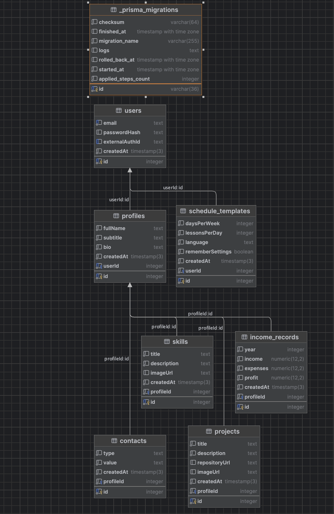

# Web Portfolio — лабораторные работы по Web-разработке

## Автор
Павел Ящищен, группа M3414.

## О проекте
Проект представляет собой веб-портфолио разработчика на NestJS. Серверная часть рендерит страницы через Handlebars, предоставляет REST и GraphQL API, работает с PostgreSQL через Prisma и использует отдельные инфраструктурные компоненты для авторизации и хранения файлов.

## ЛР 1 — деплой и шаблонизация

### Что реализовано
- приложение создано на NestJS;
- версия Node.js зафиксирована в `package.json` (`22.x`);
- сервер использует порт из переменной окружения `PORT`, а локально — `3000`;
- статические ресурсы размещены в `public/` и отдаются через `ServeStaticModule`;
- подключён шаблонизатор Handlebars;
- представления находятся в `views/`;
- повторяющиеся части вынесены в partials: общие стили/скрипты, header, меню, информация о сессии, контейнер основного содержимого, footer, карточки проектов и навыков;
- для страниц настроены NestJS-контроллеры и `@Render`;
- предусмотрены состояния интерфейса для авторизованного и неавторизованного пользователя.

### Локальный запуск
```bash
npm install
npm run start:dev
```

Приложение локально доступно по адресу: http://localhost:3000

### Render
https://m3314-yashishen.onrender.com/about

## Описание предметной области
Система хранит данные о пользователе, его профиле, навыках, проектах и контактах. Доменная модель описывает структуру персонального портфолио и позволяет использовать эти данные в веб-приложении.

## Используемые технологии
- NestJS
- Handlebars
- PostgreSQL
- Prisma ORM
- Docker
- Render
- GraphQL
- Swagger / OpenAPI
- SuperTokens
- S3-compatible Object Storage

## Сущности доменной модели

### User
Сущность пользователя системы. Хранит данные, связывающие локального пользователя с внешней системой авторизации, и связана с профилем.

### Profile
Профиль владельца портфолио. Содержит имя, подзаголовок и краткое описание.

### Skill
Навык, относящийся к профилю. Содержит название, описание и ссылку на изображение.

### Project
Проект, относящийся к профилю. Содержит название, описание, ссылку на репозиторий и изображение.

### Contact
Контактная информация владельца портфолио, например email, Telegram и GitHub.

## Связи между сущностями
- один `User` имеет один `Profile`;
- один `Profile` может иметь много `Skill`;
- один `Profile` может иметь много `Project`;
- один `Profile` может иметь много `Contact`.

# ЛР 4 — REST API

## Реализованные возможности
- RESTful API для всех сущностей
- Валидация запросов (ValidationPipe)
- Глобальная обработка ошибок (ExceptionFilter)
- Пагинация с поддержкой Link header
- Документация Swagger

## Swagger
http://localhost:3000/api/docs

# ЛР 5 — GraphQL

## Реализованные возможности

- GraphQL API (code-first подход)

- Запросы (queries) и мутации (mutations)

- Вложенные сущности через field resolvers

- Пагинация

- Ограничение сложности запроса (query complexity)

- Встроенная GraphQL песочница

## GraphQL Playground

http://localhost:3000/graphql

## Примеры запросов

### Получение портфолио с вложенными сущностями

```graphql
query {
  portfolio(id: 4) {
    id
    fullName
    subtitle
    projects {
      id
      title
    }
    skills {
      id
      title
    }
    contacts {
      type
      value
    }
  }
}
```
### Получение списка проектов
```graphql
query {
  projects(page: 1, limit: 2) {
    id
    title
    description
  }
}
```
### Примеры мутаций
#### Создание проекта
```graphql
mutation {
  createProject(
    input: {
      title: "GraphQL проект"
      description: "Создан через GraphQL"
      repositoryUrl: "https://github.com/example/repo"
      imageUrl: "/img/image.png"
    }
  ) {
    id
    title
  }
}
```
#### Обновление проекта
```graphql
mutation {
  updateProject(
    id: 10
    input: {
      title: "Обновленный проект"
    }
  ) {
    id
    title
  }
}
```
### Удаление проекта
```graphql
mutation {
  deleteProject(id: 10)
}
```

# ЛР 6 — Применение возможностей NestJS для разработки BFF

## Реализованные возможности

### Измерение времени обработки запроса
Реализован собственный interceptor (`ElapsedTimeInterceptor`), который:
- измеряет время обработки каждого запроса
- выводит результат в логи сервера
- добавляет заголовок `X-Elapsed-Time` для REST API и GraphQL
- передаёт серверное время в шаблоны (для отображения рядом с клиентским временем)

---

### Кэширование ответов

#### Клиентское кэширование
Реализовано с использованием:
- `Cache-Control`
- `ETag`
- `If-None-Match`

Поведение:
- при повторном запросе возвращается `304 Not Modified`, если данные не изменились
- уменьшается объём передаваемых данных

---

### Загрузка файлов в объектное хранилище

Реализована загрузка файлов в **Yandex Object Storage (S3-совместимое хранилище)**:
- создан отдельный инфраструктурный модуль `StorageModule`
- реализован сервис `StorageService` с использованием AWS SDK
- файлы загружаются через backend
- возвращается публичная ссылка на файл

#### Загрузка файла

## ER-диаграмма


